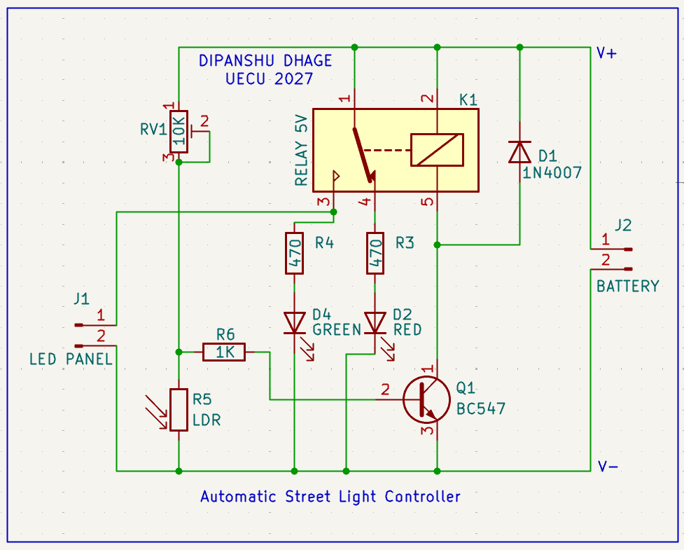
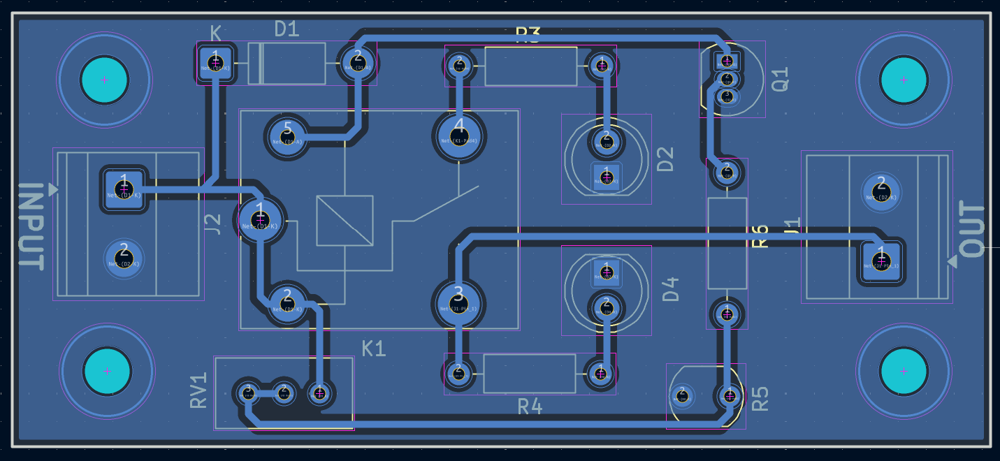
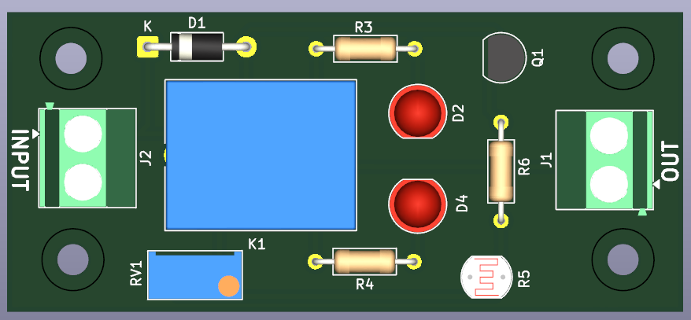
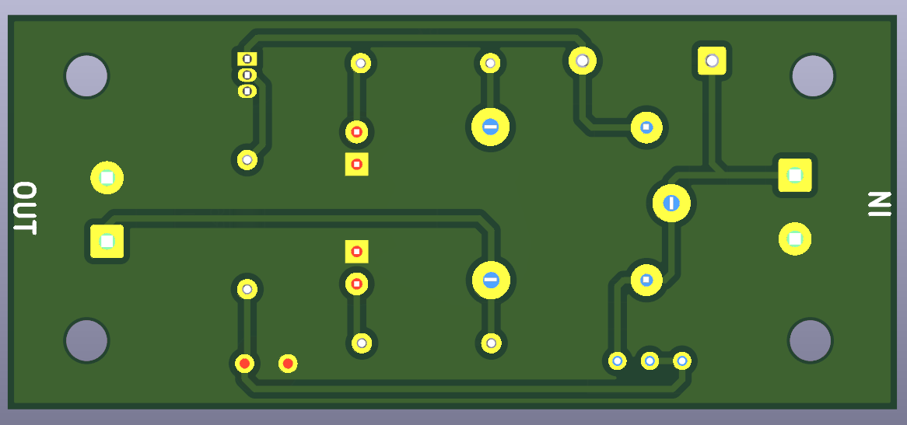
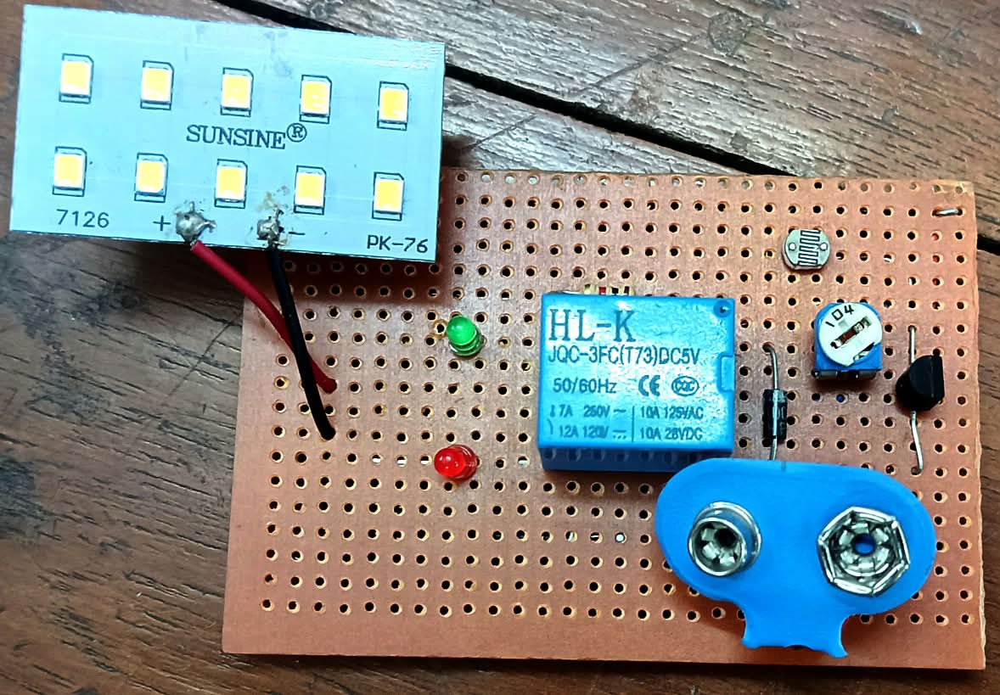
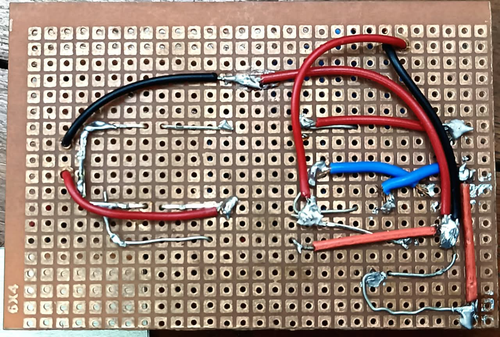

# Automatic Street Light Controller (LDR & Relay)

An analog, microcontroller-free **Automatic Street Light Controller** that switches a white LED street light panel ON at dusk and OFF at dawn using an LDR voltage divider, a BC547 NPN transistor driver, and an SPDT relay.

Originally built as a **December 2024 mini-project** on a perfboard, this repository includes both the physical prototype with a working demo clip and a custom PCB design with 3D renders and a `.step` model.

---

## Key Features
- **No Microcontroller Needed:** Purely analog light sensing and relay switching.
- **Adjustable Darkness Threshold:** Trimpot (`RV1`) to tune the dusk/dawn switching point.
- **Status Indicators:**
  - **Red LED (`D2`):** Lights up during daytime / standby (`NC` contact).
  - **Green LED (`D4`) + White LED Panel (`J1`):** Turns ON in darkness (`NO` contact).
- **Flyback Protection:** `1N4007` diode (`D1`) across the relay coil protects the `BC547` transistor (`Q1`) from coil back-EMF.

---

## Bill of Materials (BOM)

| Designator | Component | Value / Part | Qty |
| :--- | :--- | :--- | :---: |
| `K1` | SPDT Relay | 5V DC Relay (`SRD-05VDC-SL-C`) | 1 |
| `Q1` | NPN Transistor | `BC547` | 1 |
| `D1` | Flyback Diode | `1N4007` | 1 |
| `R5` | Photoresistor | 5mm LDR | 1 |
| `RV1` | Preset Trimpot | 10kΩ | 1 |
| `R6` | Resistor | 1kΩ | 1 |
| `R3`, `R4` | Resistors | 470Ω | 2 |
| `D2`, `D4` | LEDs | 5mm Red (`D2`) & 5mm Green (`D4`) | 2 |
| `J1`, `J2` | Screw Terminals | 2-Pin Connectors (`LED PANEL`, `BATTERY`) | 2 |
| `LOAD` | White LED Panel | 10-SMD White LED Module (`SUNSINE 7126 PK-76`) | 1 |

---

## Repository Structure

- `pcb-design/` — Schematic, 2D PCB layout, top/bottom 3D renders, and `Automatic-Street-Light-Controller.step`.
- `prototype-and-demo/` — December 2024 perfboard build photos and working demo video clip.

---

## PCB Design

### Schematic

### PCB Layout

### 3D Renders
| Top View | Bottom View |
| :---: | :---: |
|  |  |

*3D CAD model available at [`pcb-design/Automatic-Street-Light-Controller.step`](pcb-design/Automatic-Street-Light-Controller.step).*

---

## Prototype & Demo (December 2024)

### Working Demo Clip
Watch the circuit in action: [`prototype-and-demo/Working_Demo.mp4`](prototype-and-demo/Working_Demo.mp4)

### Perfboard Build
| Top View | Back View |
| :---: | :---: |
|  |  |

---

## License
Released under the **MIT License** (`LICENSE`).
